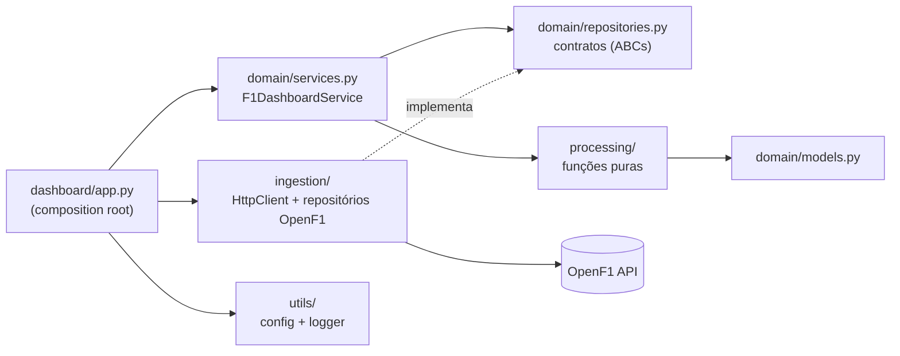

# Arquitetura

O código fica em `src/projetof1/`, organizado nas quatro camadas da skill do time,
mais uma camada de apresentação (`dashboard/`).

## Camadas

| Camada | Responsabilidade | Não pode |
| --- | --- | --- |
| `domain/` | Modelos pydantic dos payloads, projeções exibidas na tela, contratos dos repositórios (`ABC`) e o `F1DashboardService` | Importar `ingestion`, `httpx` ou `streamlit` |
| `processing/` | Funções puras: voltas válidas, top N, ritmo, setores, stints, pit stops, classificação, clima e formatação | Fazer I/O |
| `ingestion/` | `HttpClient` (timeout, retry com backoff) e os repositórios concretos da OpenF1 | Conter regra de negócio |
| `utils/` | `Settings`/`load_settings()` (com `python-dotenv`) e `get_logger`/`configure_logging` | Importar outras camadas |
| `dashboard/` | Tela Streamlit: `app.py` (composition root), `charts.py` (figuras Plotly, puras) e `components.py` (cards, tabelas, CSS) | Acessar a API diretamente |

## Injeção de dependências

O `app.py` é o único lugar que monta as implementações concretas:

1. `load_settings()` lê o `.env` e as variáveis de ambiente.
2. Cria o `HttpClient` com a URL e o timeout configurados.
3. `build_repositories(client)` devolve um `F1Repositories` com os oito repositórios OpenF1.
4. O `F1DashboardService` recebe esse conjunto pelo construtor.

Nos testes, os repositórios são substituídos por mocks (`mocker.create_autospec`) e o
`HttpClient` usa `httpx.MockTransport`, então nenhum teste unitário acessa a rede.

## Decisões técnicas

| Decisão | Motivo |
| --- | --- |
| `httpx` | Timeout explícito e `MockTransport` para testar sem rede |
| `pydantic` v2 | Valida os payloads da API; campos extras são ignorados |
| `plotly` | Gráficos interativos com cores das equipes e linha do tempo de pneus |
| `dashboard/` fora das quatro camadas | Separa a apresentação; `charts.py` é testável sem subir o Streamlit (desvio da estrutura padrão justificado) |
| HTTP 404 = lista vazia | A OpenF1 responde `404 {"detail": "No results found."}` a consultas sem dados |
| Retry só em timeout, falha de transporte, 429 e 5xx | Erros transitórios; o plano gratuito limita requisições por segundo |
| Itens inválidos ignorados e contados no log | Mantém o dashboard resiliente sem descartar dados em silêncio |
| Voltas de ritmo filtradas a 107% da mediana | Remove safety car e tráfego da comparação de ritmo |
| Cache do Streamlit com TTL por ambiente | 1 h em `development`, 24 h em `staging`/`production` |
| Seletores com `key` ligada ao item pai e ids como opções | GP por temporada (`meeting-{ano}`), sessão por GP (`session-{meeting_key}`). Sem isso, ao trocar de GP o Streamlit mantinha a sessão do GP anterior quando o nome se repetia ("Race") |
| Dois rankings de voltas (`fastest_laps` e `fastest_laps_overall`) | Melhor volta por piloto ou voltas gerais da sessão; o serviço calcula até 20 e a tela escolhe quantas exibir |

## Fluxo de uma tela

1. O usuário escolhe temporada, GP e sessão (`list_meetings`, `list_sessions`).
2. Sessões futuras mostram um aviso, sem chamar a API.
3. `get_session_overview(session)` busca pilotos, voltas, stints, pit stops, resultado
   e clima, e devolve um `SessionOverview` com as projeções prontas.
4. As abas desenham o `SessionOverview` com `charts` e `components`.
5. Se a OpenF1 falhar depois dos retries, a tela mostra uma mensagem amigável e o
   detalhe vai para o log.
